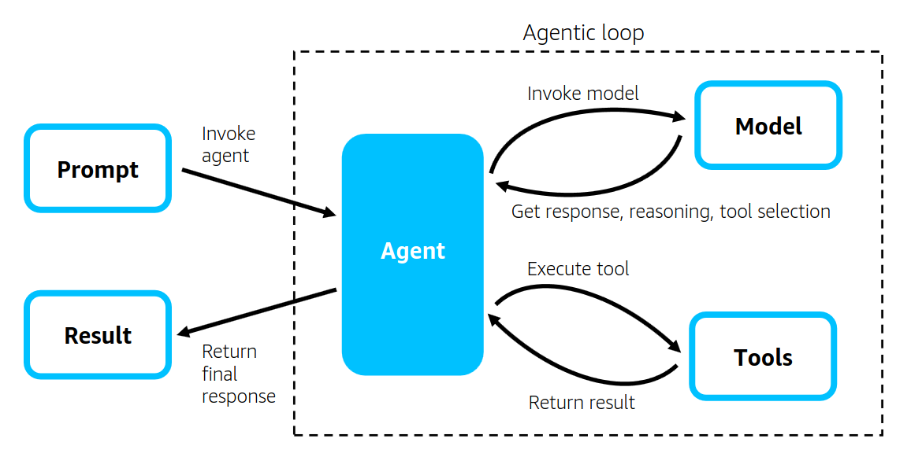
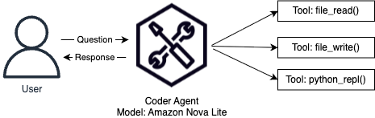
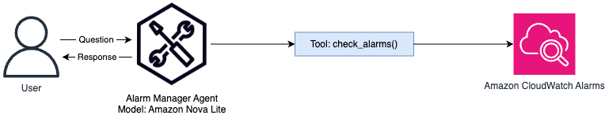
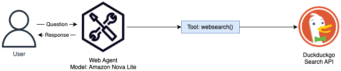

# Creating an AWS DevOps AI Agent with the Strands Agents SDK

Self notes from the lab *Creating an AWS DevOps AI Agent with the Strands Agents SDK* (SPL-TF-300-MLAIST-1). The lab builds four specialist agents (coding, alarm monitoring, web research, AWS documentation research, AWS resource management) and then combines them under one orchestrator agent that can check an alarm and launch an EC2 instance from a plain-English request.


| Task | What it covers | Code |
|---|---|---|
| 1 | Agents for coding, alarm monitoring and web research | [resources/lab.ipynb](resources/lab.ipynb) |
| 2 | AWS documentation agent using an MCP server | [resources/aws_researcher.py](resources/aws_researcher.py) |
| 3 | AWS resource management agent (DynamoDB, S3) | [resources/aws_manager.py](resources/aws_manager.py) |
| 4 | Orchestrator that uses all the agents as tools | [resources/orchestrator.py](resources/orchestrator.py), [coder.py](resources/coder.py), [alarm_manager.py](resources/alarm_manager.py) |

## The big picture

```
User prompt
    └── Orchestrator agent (Amazon Nova Pro)
            ├── coder          -> read and write local files, run Python
            ├── alarms         -> CloudWatch alarms in ALARM state (boto3)
            ├── aws_researcher -> AWS Documentation MCP server
            └── aws_manager    -> AWS API MCP server (call_aws)
```

The specialist agents use Amazon Nova Lite. Only the orchestrator uses Nova Pro, because routing and combining results is the harder job.

## Task 1: Agents for coding, alarms and web research

Notebook: [resources/lab.ipynb](resources/lab.ipynb)

### 1.1 Setup

- The lab runs in the Code Editor (VS Code in the browser) with Python 3.13. The kernel to pick is the existing `/usr/bin/python3.13`, not "Create Python Environment".
- The EC2 instance profile already has `bedrock:InvokeModelWithResponseStream`. A Strands agent needs that permission plus valid credentials (or a Bedrock API key).

### 1.2 A basic agent



The agentic loop: the agent receives a prompt, the model decides what to do, a tool is called if needed, and the result goes back to the model until it can answer.

```python
import boto3
from strands import Agent
from strands.models import BedrockModel

use1_session = boto3.Session(region_name="us-east-1")
usw2_session = boto3.Session(region_name="us-west-2")

nova_lite = BedrockModel(model_id="amazon.nova-lite-v1:0", boto_session=use1_session)
basic_agent = Agent(model=nova_lite)
```

- By default `Agent` uses Bedrock with Claude. Using `BedrockModel` with a boto3 session lets me choose the model and region.
- Test: "Write a file called flights.csv to my file system". The agent had no tools, so it only explained how to write the file with Python. It did not create anything. This is the difference between a model and an agent with tools.

### 1.3 A coding assistant (built-in tools)



| Tool | Purpose |
|---|---|
| `file_read` | Read files (view mode) |
| `file_write` | Write files |
| `python_repl` | Run Python code |

```python
from strands_tools import file_read, file_write, python_repl

coder_agent = Agent(
    model=nova_lite,
    system_prompt="""You are a helpful assistant.
    You can read from the local file system to answer questions
    and write to it when asked.""",
    tools=[file_read, file_write, python_repl],
    callback_handler=None,
)
```

What I did and saw:

1. **Read a schema.** With only `file_read`, the agent read `flights-schema.csv` and listed the required fields: Origin, Destination, DepartureTime and Arrival. `FlightNumber` was optional.
2. **Write data.** With `file_write` added, it generated five flight rows that followed the schema and wrote `flights.csv`.
3. **Consent prompts.** Write tools ask for confirmation in a terminal. In a notebook there is no terminal, so the lab sets `os.environ["BYPASS_TOOL_CONSENT"] = "true"`.
4. **Direct tool calls.** A tool can be called without the model: `coder_agent.tool.file_read(path="./project/flights.csv", mode="view")`.
5. **Validate with code.** `coder_agent.tool.python_repl(code=...)` ran a script that checked the CSV exists and parses. Result: `Validation result: True`.

Notes:

- `callback_handler=None` stops the agent printing its response as it streams. Without it the answer appears twice in a notebook (once streamed, once from `print(response)`).
- `python_repl` printed a deprecation warning. The suggested replacement is the version from `strands.vended_tools`.
- The `SlidingWindowConversationManager` is the default and keeps the recent message window.
- The sample file the agent wrote must exist and be well formed, because later tasks (DynamoDB) depend on it.

### 1.4 Alarm monitoring agent (custom tool)



A custom tool is a normal Python function with the `@tool` decorator. The docstring and type hints tell the model how to use it.

```python
from strands import tool

@tool
def alarms(alarm_name: str) -> str:
    try:
        cloudwatch_use1 = use1_session.client("cloudwatch")
        cloudwatch_usw2 = usw2_session.client("cloudwatch")
        MetricAlarms = (
            cloudwatch_use1.describe_alarms(StateValue="ALARM")["MetricAlarms"]
            + cloudwatch_usw2.describe_alarms(StateValue="ALARM")["MetricAlarms"]
        )
        if not MetricAlarms:
            return "No alarms are currently in ALARM state"
        names = [a["AlarmName"] for a in MetricAlarms]
        return f"{len(names)} alarm(s) in ALARM state: {', '.join(names)}"
    except:
        return "An error occurred checking alarm with boto3"
```

- It checks two regions (us-east-1 and us-west-2) and returns a string, because a short descriptive string is the easiest thing for a model to use.
- Result: one alarm in ALARM, `Client-System-Down`. This is the "client system is down" signal that Task 4 acts on.
- Improvement ideas: the `alarm_name` parameter is never used, and the bare `except` hides the real error. A better tool would log the exception and accept an optional alarm name filter.

### 1.5 Web research agent



```python
from ddgs import DDGS

@tool
def websearch(keywords: str, region: str = "us-en", max_results: int | None = None) -> str:
    """Search the web to get updated information."""
    try:
        results = DDGS().text(keywords, region=region, max_results=max_results)
        return results if results else "No results found."
    except Exception as e:
        return f"Exception: {e}"
```

- The DuckDuckGo search library (`ddgs`) gets around the model's training cutoff by fetching fresh pages.
- The tool handles rate limiting (`RatelimitException`) separately so the agent can tell the user to retry.
- The system prompt says when to use the tool ("Use the websearch tool to find up to date information"). With Strands, telling the agent when and how to use a tool makes its behaviour more predictable.
- Result: a summary of 2025 GenAI trends (multimodal models, agentic AI, AI-ready data). The summary mixes sources, so for anything important the links should be checked.

## Task 2: AWS documentation agent with an MCP server

Code: [resources/aws_researcher.py](resources/aws_researcher.py)

The Model Context Protocol (MCP) is a standard way to give models tools and context. AWS publishes many MCP servers. This task uses the AWS Documentation MCP server, started locally with `uvx` (a Python package runner) and a standard input/output (stdio) connection.

```python
from mcp import stdio_client, StdioServerParameters
from strands.tools.mcp import MCPClient

documentation_mcp_server = MCPClient(
    lambda: stdio_client(
        StdioServerParameters(command="uvx", args=["awslabs.aws-documentation-mcp-server"])
    )
)

with documentation_mcp_server:
    tools = documentation_mcp_server.list_tools_sync() + [file_write]

aws_documentation_agent = Agent(
    model=nova_lite,
    system_prompt="""You are a thorough AWS researcher specialized in finding accurate
    information online. For each question:
    1. Determine what information you need
    2. Search the AWS Documentation for reliable information
    3. Extract key information and cite your sources
    4. Store important findings in memory for future reference
    5. Synthesize what you've found into a clear, comprehensive answer
    When researching, focus only on AWS documentation. Always provide citations
    for the information you find.""",
    tools=tools,
)

response = aws_documentation_agent(query)
return str(response)
```

- The server provides three tools: `search_documentation`, `read_documentation` and `recommend`.
- The agent searched first, then read the best page, then wrote the answer (for example, "What is Amazon Bedrock?").
- `list_tools_sync()` returns the server's tools, and I can add my own (here `file_write`) to the same list.
- The MCP client must be connected when the tools are actually called, so check where the `with` block ends in the complete lab code.
- The system prompt limits the agent to AWS documentation and requires citations. A tightly scoped prompt keeps a specialist agent from wandering.
- Run it with `python -u agents/aws_researcher.py`. The `-u` flag unbuffers output so the agent's steps show up live.

## Task 3: AWS resource management agent

Code: [resources/aws_manager.py](resources/aws_manager.py)

This agent uses the AWS API MCP server, which exposes a `call_aws` tool that can run AWS CLI-style commands, plus `file_read` and a `sleep` tool.

**3.1 Create and fill a DynamoDB table**

Prompts I used:

1. `Create a dynamodb table called flights with string key "FlightNumber"`
2. `Put batch.json in dynamodb table 'flights'`

Observed behaviour:

- The agent runs `call_aws` (`aws dynamodb create-table ...`), reads the result, and reports the table as `CREATING`.
- For the batch load it called `file_read` on `batch.json`, converted the content into the DynamoDB batch-write format, ran `call_aws`, waited with `sleep`, and listed tables to confirm.
- It sometimes fails and retries. It learns the right parameters from each error. The system prompt gives it permission to assume missing values instead of asking.
- I verified in the console: DynamoDB, Tables, `flights`, Explore table items.

**3.2 Handle all AWS operations**

The system prompt tells the agent which tool to use for each kind of request:

```python
system_prompt="""You are an AWS operations assistant with access to multiple AWS services.

When handling requests:
- For all AWS operations: Use the AWS API MCP tools
- For file operations: Use the file_read tool
- To sleep: Use the sleep tool

Example uses:
- "Create an EC2 instance" → use the AWS API MCP tools
- "Query DynamoDB table" → use the AWS API MCP tools
- "Read configuration file" → use file_read tool
- "Sleep for 10 seconds" → use sleep tool"""
```

Test: `Tell me what S3 buckets I have in us-east-1` returned the lab's buckets.

Short examples inside a system prompt (the "→ tool" lines) work like few-shot examples and make tool choice more reliable.

## Task 4: Orchestrator agent ("agents as tools")

Code: [resources/orchestrator.py](resources/orchestrator.py), [coder.py](resources/coder.py), [alarm_manager.py](resources/alarm_manager.py), [aws_researcher.py](resources/aws_researcher.py), [aws_manager.py](resources/aws_manager.py)

**The pattern**

- A primary orchestrator agent talks to the user and decides which specialist to call.
- Each specialist agent is wrapped as a tool and does one domain task.
- This replaces one large agent that tries to do everything.

**Step 1: Make each agent a tool.** Add `@tool` above the four functions:

```python
@tool
def coder(query: str) -> str: ...

@tool
def alarms(alarm_name: str) -> str: ...

@tool
def aws_researcher(query: str) -> str: ...

@tool
def aws_manager(query: str) -> str: ...
```

**Step 2: Build the orchestrator.** It imports the four tools and uses Amazon Nova Pro:

```python
from coder import coder
from aws_researcher import aws_researcher
from alarm_manager import alarms
from aws_manager import aws_manager

ORCHESTRATOR_SYSTEM_PROMPT = """
You are an assistant that routes queries to specialized agents:
- When asked to code or read a local file → Use the coder tool
- When asked to check on AWS account health → Use the alarms tool
- When asked to perform research on AWS → Use the aws_researcher
- When asked to perform an action in AWS -> Use aws_manager. Do not sleep after performing the action
- For simple questions not requiring specialized knowledge → Answer directly
Always select the most appropriate tool based on the user's query.
Do not prompt the user again until a task is complete.
"""

# tools=[coder, alarms, aws_researcher, aws_manager]
```

**Step 3: One prompt, several agents.** Run `python -u agents/orchestrator.py` and enter (with `SUBNET_ID` and `REGION` replaced by the lab's values):

```
Check if an alarm indicates the client system is down. If it is, create a single backup
EC2 instance in REGION using the AnyCompanyFlightTracker launch template in subnet
SUBNET_ID and give me the public IP from the response
```

What happened:

1. The orchestrator called `alarms` and found the client-system-down alarm in ALARM state.
2. It called `aws_manager`, which ran `call_aws` to launch an EC2 instance from the `AnyCompanyFlightTracker` launch template (a t2.micro in the lab's subnet).
3. It returned the instance ID and public IP.
4. After the instance finished starting (up to five minutes), the public IP showed a web page with the flight data from DynamoDB.

The agents recovered from AWS errors by retrying with corrected parameters.

## Knowledge check

Passed. The questions are not included here.

## Lessons learned

- A model alone explains; an agent with tools acts. The first `flights.csv` test showed the difference.
- Docstrings, type hints and system prompts are the interface between the model and the tools. Say exactly when each tool should be used.
- Return short, descriptive strings from custom tools.
- Specialist agents with narrow prompts are easier to test than one big agent. Test each one alone before adding it to the orchestrator.
- MCP servers give an agent ready-made tools (AWS documentation, AWS APIs) without writing the integration.
- Use a smaller, cheaper model (Nova Lite) for specialists and a stronger one (Nova Pro) for orchestration.
- Run agents with `python -u` so output is not buffered.
- Agents can retry and self-correct, but that costs extra model calls. Cap retries in production.

## Production considerations

- **Least privilege.** `aws_manager` can run any AWS operation the instance role allows. In production the role should be scoped to specific services and resources.
- **Human approval.** `BYPASS_TOOL_CONSENT=true` turns off confirmation for file writes. Keep confirmations on for destructive or expensive actions (terminate instance, delete table).
- **Cost.** Launching EC2 instances from a prompt can add cost. Add guardrails such as an allowed instance type and a limit on instance count.
- **Observability.** Log every tool call and its arguments so a person can audit what the agent did.
- **Error handling.** The alarm tool's bare `except` hides the cause of failures. Log the exception.
- **Web search.** Search results can be wrong or manipulated. Show sources and don't act on them without checking.

## Related notes

- [AgentCore Runtime lab notes](AgentCore_Runtime_Lab_Notes.md): multi-agent finance assistant deployed to AgentCore Runtime.
- [AgentCore memory and gateway lab notes](AgentCore_Lab_Notes.md): Memory, Gateway and Identity.

## Before publishing

- `lab.ipynb` has output cells with embedded diagram images, so the file is large. In VS Code run **Clear All Outputs** before committing. The notebook paths point to the lab's `/home/ec2-user/environment` folder.
- The code needs the lab environment (Bedrock permissions, `uvx`, the launch template and the `project` folder), so it will not run elsewhere.
- Replace any account IDs, subnet IDs, instance IDs or IP addresses in saved output before sharing.
