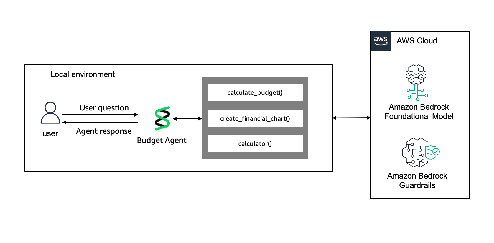
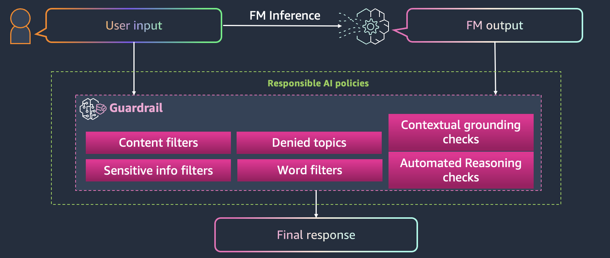
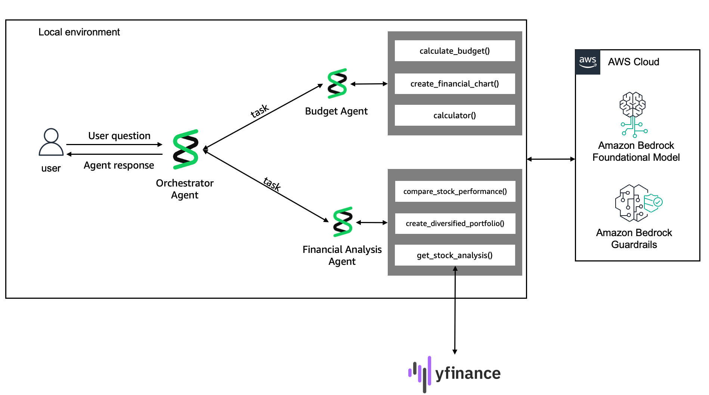
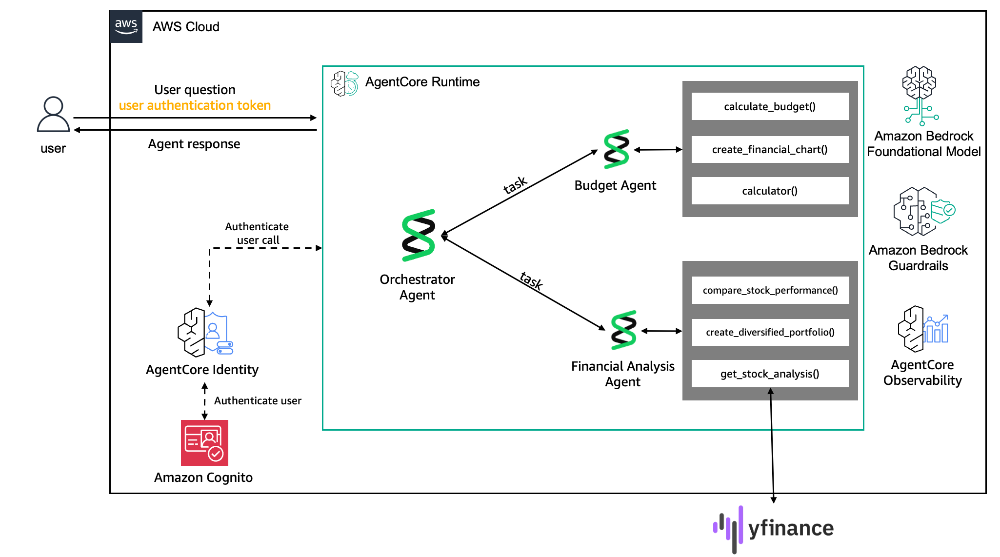

# Deploying Intelligent Agents with Amazon Bedrock AgentCore Runtime

Self notes from the lab *Deploying Intelligent Agents with Amazon Bedrock AgentCore Runtime* (SPL-TF-300-MLADAS-1). The lab builds a personal finance assistant in three stages: a single budget agent, a multi-agent system, and a production deployment on AgentCore Runtime.

### Notebooks

| Task | Notebook | What it covers |
|---|---|---|
| 1 | [Task-1.ipynb](Task-1.ipynb) | Single budget agent: guardrail, system prompt, conversation manager, streaming, tools, structured output |
| 2 | [Task-2.ipynb](Task-2.ipynb) | Multi-agent system with the "Agents as Tools" pattern |
| 3 | [Task-3.ipynb](Task-3.ipynb) | Deployment on AgentCore Runtime with Cognito auth and Memory |
| 4 | [aws_cleanup.ipynb](aws_cleanup.ipynb) | Deleting the resources created in the lab |

### Images

| Image | Used in |
|---|---|
|  | [Task 1](#task-1-personal-budget-assistant-strands-agents) |
|  | [Task 1](#task-1-personal-budget-assistant-strands-agents) |
|  | [Task 2](#task-2-multi-agent-system-agents-as-tools) |
|  | [Task 3](#task-3-deploy-on-agentcore-runtime) |
|  | [Task 3](#task-3-deploy-on-agentcore-runtime) |

## The big picture

| Task | What I built | Main idea |
|---|---|---|
| 1 | Budget agent with tools, guardrails, conversation manager and structured output | One specialized agent, configured step by step |
| 2 | Budget agent, financial analysis agent and an orchestrator | "Agents as Tools" pattern |
| 3 | The orchestrator deployed to AgentCore Runtime with Cognito auth and Memory | Moving from a notebook to a managed, serverless runtime |
| 4 | Cleanup | Delete the runtime, ECR repository, Cognito pool and other resources to avoid charges |

## Task 1: Personal budget assistant (Strands Agents)

Notebook: [Task-1.ipynb](Task-1.ipynb)


**Model and guardrail**

- Model: Amazon Nova Pro (`us.amazon.nova-pro-v1:0`) with `temperature=0.0` so financial answers are deterministic.
- A Bedrock Guardrail (`guardrail-no-bitcoin-advice`) was attached to the model with `guardrail_id`, `guardrail_version="DRAFT"` and `guardrail_trace="enabled"`.
- When the guardrail fires, Strands overwrites the blocked user message in the history with `[User input redacted.]`, so follow-up questions are not blocked too.
- Test: "Bitcoin investment advice" was refused, and the message history showed the redacted input.


**Building the agent in steps**

1. **System prompt:** a personal finance persona that gives budgeting advice, 2 to 3 concrete steps, and no investment advice.
2. **Conversation manager:** `SummarizingConversationManager` with `summary_ratio=0.5` and `preserve_recent_messages=3`. Strands has three managers: sliding window (the default), null, and summarizing. Summarizing keeps older context instead of dropping it.
3. **Streaming:** `agent.stream_async(query)` yields text chunks as they are generated. Good for chat UIs and long answers, unnecessary for batch jobs.
4. **Tools:** `calculate_budget` (the 50/30/20 rule), `create_financial_chart` (matplotlib pie chart) and the built-in `calculator`.
5. **Structured output:** Pydantic models `BudgetCategory` and `FinancialReport`, used through `agent.structured_output(output_model=..., prompt=...)`. The result is a typed Python object, not free text.

**Things I noticed**

- The first structured output call returned no recommendations. The version exported to `budget_agent.py` had an improved system prompt and returned three recommendations and a score of 7/10. A clearer prompt fixed it.
- The `@tool` docstring is what the model reads to decide when to call a tool.

## Task 2: Multi-agent system ("Agents as Tools")

Notebook: [Task-2.ipynb](Task-2.ipynb)


| Agent | Role | Tools |
|---|---|---|
| Budget agent | Budgeting and spending | `calculate_budget`, `create_financial_chart`, `calculator` |
| Financial analysis agent | Investment research | `get_stock_analysis`, `create_diversified_portfolio`, `compare_stock_performance` (yfinance) |
| Orchestrator | Routes questions and combines answers | `budget_agent_tool`, `financial_analysis_agent_tool` |

**How the pattern works**

- Each specialist agent is wrapped in a `@tool` function. The orchestrator sees them as ordinary tools and calls them with a focused query.
- `budget_agent_tool` returns a `FinancialReport` object. `financial_analysis_agent_tool` returns text.
- The orchestrator prompt says which agent handles which topic and tells it to combine the results and give next steps.
- Each agent was also exported to its own `.py` file with `%%writefile`, so the next task could import them.

**Results**

- "I make $6000/month and want to start investing $500/month" called both agents and produced a budget, a moderate-risk portfolio and next steps.
- A test asking whether $2000 could be invested on $4000 income compared Tesla and Apple, but the budget tool returned an error and the orchestrator asked for more budget details. Multi-agent systems can fail partway, and the orchestrator needs to handle a missing result.
- The financial analysis agent's input validation (negative amounts, invalid risk levels, empty symbol lists) was added in the exported version.

## Task 3: Deploy on AgentCore Runtime

Notebook: [Task-3.ipynb](Task-3.ipynb)


**Making the agent deployable**

```python
app = BedrockAgentCoreApp()

@app.entrypoint
async def invoke(payload):
    ...
    async for event in orchestrator_agent.stream_async(user_message):
        if "data" in event:
            yield event["data"]

if __name__ == "__main__":
    app.run()
```

`BedrockAgentCoreApp` starts an HTTP server on port 8080 with `/invocations` (requests) and `/ping` (health checks) endpoints, and handles content types and errors.

**Authentication (Amazon Cognito)**

- The runtime requires authentication. A Cognito user pool and app client were created, and the credentials were stored in AWS Secrets Manager.
- The runtime uses a `customJWTAuthorizer` with `allowedClients` and the Cognito `discoveryUrl`.
- Callers send `Authorization: Bearer <JWT>` and an `X-Amzn-Bedrock-AgentCore-Runtime-Session-Id` header.

**AgentCore Memory (three strategies)**

| Strategy | Stores | Namespace |
|---|---|---|
| Semantic | Financial facts (income, expenses, goals) | `finance/user/{actorId}/facts` |
| User preference | Risk tolerance, budget priorities | `finance/user/{actorId}/preferences` |
| Summary | Conversation summaries | `finance/user/{actorId}/sessions/{sessionId}` |

The memory ID is passed to the runtime as the environment variable `AGENTCORE_MEMORY_ID`.

**Configure and launch**


1. `Runtime().configure(entrypoint="main.py", execution_role=..., auto_create_ecr=True, requirements_file="requirements.txt", authorizer_configuration=auth_config)` generates a Dockerfile.
2. `agentcore_runtime.launch(env_vars={...})` builds the ARM64 image in AWS CodeBuild (about 49 seconds), pushes it to ECR, and creates the runtime and its `DEFAULT` endpoint.
3. Verification showed the ECR repository (one image, about 238 MB) and a runtime with status `READY`.
4. Invocation is a streaming HTTPS POST to `bedrock-agentcore.<region>.amazonaws.com/runtimes/<escaped-arn>/invocations`.

The "platform mismatch (linux/amd64 vs linux/arm64)" warning is safe to ignore here, because CodeBuild builds the ARM64 image in the cloud.

## Task 4: Cleanup

Notebook: [aws_cleanup.ipynb](aws_cleanup.ipynb)

The cleanup notebook removes the runtime, ECR repository, Cognito user pool and related resources in dependency order. Run it when finished so the account does not keep accruing charges.

## Things worth checking (my own observations)

- **Memory calls may not match the SDK.** The lab's `main.py` calls `memory_client.query_records(...)` and `create_event(content=...)`. In my customer support project I used `retrieve_memories(...)` and `create_event(messages=[(text, "USER"), ...])`. The lab wraps its memory calls in `try/except` and only logs a warning, so a mismatch would fail silently. If memory seems to do nothing, check the runtime logs for `Error retrieving memories` or `Error storing memory`.
- **Shared agent state.** The lab sets `orchestrator_agent.system_prompt` on one module-level agent for every request. Memory context from one user could carry over to the next request. Production code should create the agent (or its prompt) per request or per session.
- **Defaults.** An unknown `actor_id` falls back to `"default_user"`, which would mix every anonymous user's memory together.
- **Observability.** `OTEL_PYTHON_EXCLUDED_URLS` removes `/ping` and `/invocations` from traces to cut noise. Runtime logs are in CloudWatch under `/aws/bedrock-agentcore/runtimes/<agent-id>-DEFAULT`.
- **Disclaimers.** Financial agents should always state that output is educational, not advice. The prompts and tool outputs in this lab do that.

## Comparison with my customer support agent project

| Topic | This lab | Customer support project |
|---|---|---|
| Pattern | Orchestrator plus agents as tools | One agent with many tools (Gateway, KB, Code Interpreter, Browser) |
| Deployment | CodeBuild container (ARM64) | Direct code deploy (ZIP) |
| Auth | Cognito JWT on the runtime | Gateway with the `NONE` authorizer |
| Memory | Three strategies, hand-written calls | Two strategies, `MemoryHook` with Strands hooks |
| Entrypoint | Async generator that streams chunks | Returns the final text |

## Key takeaways

- Specialize agents, then combine them: smaller prompts and tool sets are easier to test than one large agent.
- Structured output (Pydantic) makes agent results usable by other code.
- Guardrails belong at the model level, not only in the prompt.
- Wrapping an agent in `@tool` is all it takes to make it a sub-agent.
- `BedrockAgentCoreApp` plus `@app.entrypoint` and `app.run()` is the whole contract for AgentCore Runtime.
- Test the deployed agent over HTTP the way a client would, with a bearer token and a session ID.
- Always clean up lab resources.

## Before publishing the notebooks

`Task-3.ipynb` has output cells that print the Cognito username, password, a full bearer token (JWT), the user pool ID, client ID and the AWS account ID. The credentials are temporary and belong to a lab account, but don't publish them. In VS Code or Jupyter, choose **Clear All Outputs** on each notebook, save, and check the file with a text search for `Bearer Token` and `Password` before you commit. Also remember that the lab asks not to enter personal or confidential information into the lab environment.

The notebooks import `utils` (guardrail and Cognito helpers) and show images from the lab's `images` folder, so they will not fully run outside the lab. The images render in the notebooks on GitHub only if the `images` folder sits next to them, which is how this repo is laid out.
