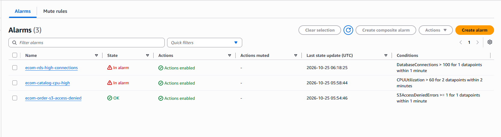
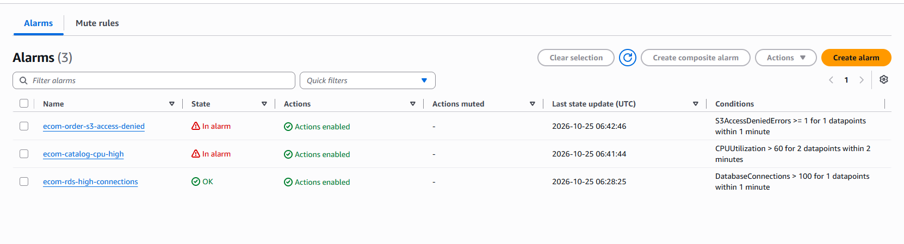
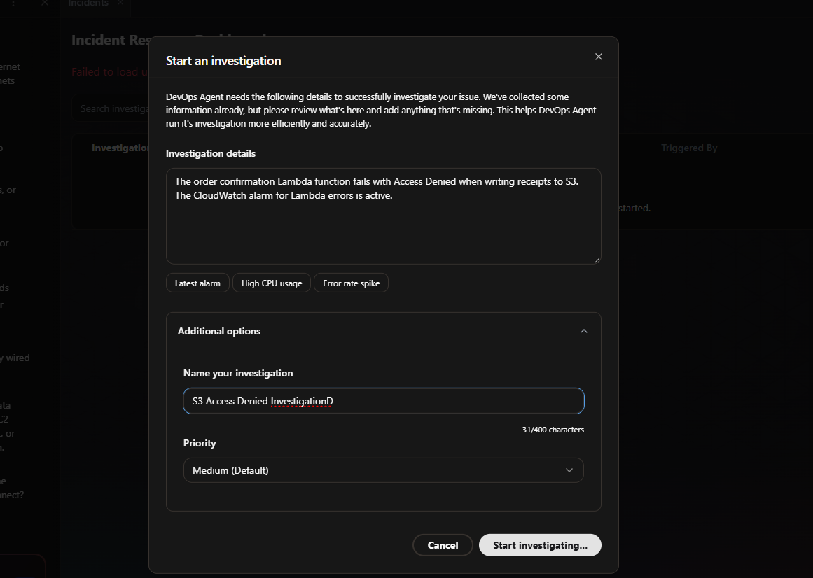
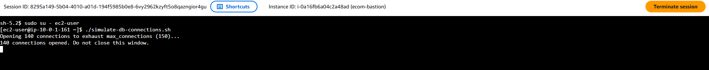
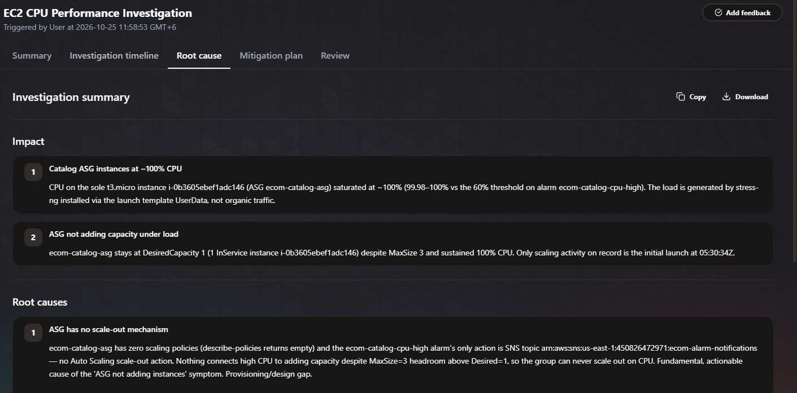
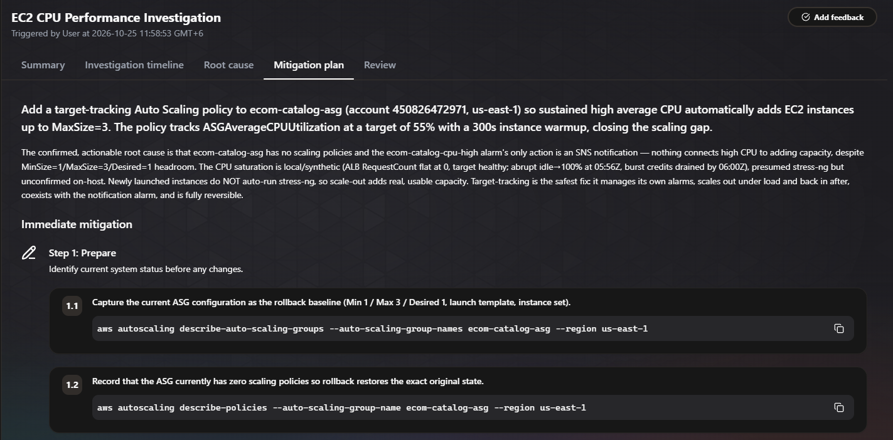
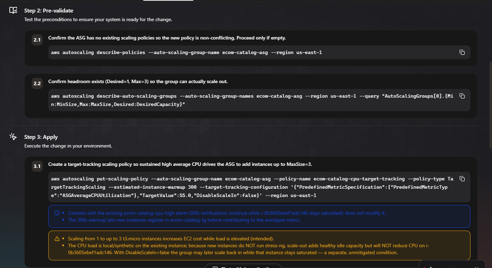
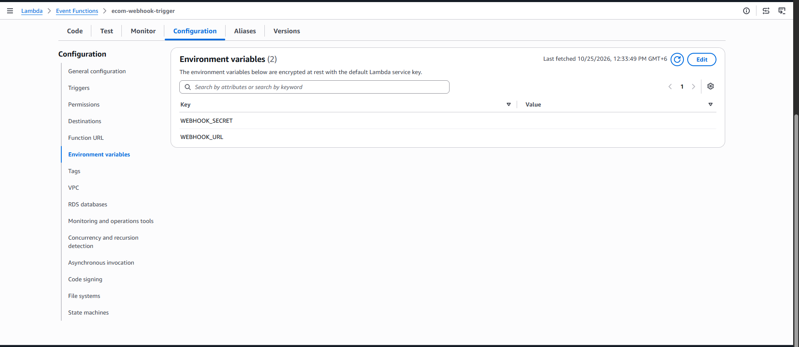
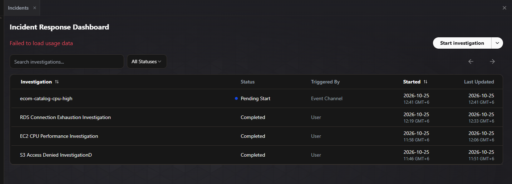

# Resolving Application Failures and Automating Investigations with AWS DevOps Agent

Self notes from the lab *Resolving Application Failures and Automating Investigations with AWS DevOps Agent* (SPL-TF-200-DORFAI-1). This is the second DevOps Agent lab. The first one investigated a single alarm. This one investigates three different failures (serverless, compute, database) and then automates the whole thing so a CloudWatch alarm starts an investigation without anyone clicking.


## Scenario

AnyCompany runs an e-commerce platform. After a recent deployment, three problems appeared:

| # | Component | Problem |
|---|---|---|
| 1 | Order confirmation **Lambda** (`ecom-order-confirmation`) | Fails with Access Denied when writing receipts to S3 |
| 2 | Product catalog on an **EC2 Auto Scaling Group** | CPU spikes slow down responses and the group does not add instances |
| 3 | Customer database on **RDS MySQL** | Runs out of connections at peak traffic |

The Agent Space (`ecom-investigation`) is already set up. The work is to investigate each problem with DevOps Agent, fix the S3 one, review the recommendations for EC2 and RDS, and then set up automatic investigations.

## Architecture

```
ecom-order-confirmation (Lambda) ──> S3 receipts bucket, DynamoDB
ecom-cpu-load-trigger (Lambda) ──> Systems Manager ──> CPU stress on the Auto Scaling Group (behind an ALB)
Bastion host (EC2) ──> RDS MySQL

CloudWatch alarms ──> Amazon SNS ──> ecom-webhook-trigger (Lambda) ──> signed webhook ──> DevOps Agent investigation
```

| Alarm | Watches |
|---|---|
| `ecom-order-s3-access-denied` | Errors from the order Lambda |
| `ecom-catalog-cpu-high` | CPU on the Auto Scaling Group |
| `ecom-rds-high-connections` | Connections on the RDS database |



## Task 1: Explore the pre-configured Agent Space

1. Console, **DevOps Agent**, open the `ecom-investigation` Agent Space, then **Operator access** (opens the Operator Web App).
2. Main areas of the app: Incidents, Improvements, Topology, Artifacts, Chat.
3. Chat prompt:

```
Describe my application architecture. Give me a summary of its key components.
```

The answer covers networking, compute and data stores, and flags the active `ecom-order-s3-access-denied` alarm.

## Task 2: Lambda and S3 Access Denied

### 2.1 See the failure

Test the `ecom-order-confirmation` Lambda with an empty event `{}`. It runs but returns `statusCode 500` with an `AccessDenied` error on `PutObject`.



### 2.2 Investigate

In the Operator Web App, **Incidents, Start Investigation**:

- **Investigation details:** The order confirmation Lambda function fails with Access Denied when writing receipts to S3. The CloudWatch alarm for Lambda errors is active.
- **Investigation starting point:** CloudWatch alarm for Lambda errors on the order confirmation function. Investigate why S3 writes are being denied.
- **Name:** `S3 Access Denied Investigation`



An `aidevops:DescribeSupportLevel` error may show in a dropdown. The lab says to ignore it.

The **Root cause** tab traces the problem to a recent CloudFormation change that introduced a typo in the bucket policy, which blocks the Lambda's IAM role.

### 2.3 Fix it

The bucket policy (bucket `ecom-receipts-<account ID>`) has a Deny that names the role `ecom-order-function-role**s**`. The real role is `ecom-order-function-role`. One extra letter blocks every write.

Fix: S3, the bucket, **Permissions**, **Bucket policy**, **Edit**, remove the trailing `s`, **Save changes**. Test the Lambda again and it returns `statusCode 200`. The alarm returns to OK within a minute or two.

The lab skips the mitigation plan here. The cause is clear and the fix is one character, so a full runbook would cost time without adding value.

## Task 3: EC2 CPU and Auto Scaling

### 3.1 Trigger the load

Run the `ecom-cpu-load-trigger` Lambda with `{}` four times. Each run starts a 5-minute CPU stress test on the Auto Scaling Group instances through Systems Manager and returns 200 with the instance IDs. The `ecom-catalog-cpu-high` alarm goes **In alarm** after 2 to 5 minutes.



### 3.2 Investigate

- **Investigation details:** The product catalog EC2 instances are experiencing high CPU usage. The Auto Scaling Group is not adding instances as expected.
- **Investigation starting point:** CloudWatch alarm for ASG CPU utilization on the product catalog service. Note: a Lambda function is simulating a CPU load event for testing purposes. Investigate the scaling behavior and why the Auto Scaling Group is not adding instances.
- **Name:** `EC2 CPU Performance Investigation`

The "simulating a CPU load event" sentence matters. Without it, the agent may treat the load as suspicious activity.

Result: the root cause is a missing or misconfigured scaling policy on the Auto Scaling Group. Without a scaling policy, the group size stays fixed no matter the demand.



Follow-up chat prompt: `Why did the Auto Scaling Group not add more instances?` The answer explains the scaling behaviour from the group's configuration (thresholds, cooldowns, limits).

### 3.3 Mitigation plan

Choose **Generate mitigation plan** (takes several minutes). It recommends a **target tracking scaling policy** based on CPU, written as a runbook (preparation, pre-validate, apply, post-validate, rollback), plus an agent-ready spec.





In this lab the plan is not applied. As the DevOps engineer, I share the runbook with the product catalog team to review and execute.

## Task 4: RDS connection exhaustion

### 4.1 Trigger it

1. EC2, instance `ecom-bastion`, **Connect**, **Session Manager** (a browser shell, no SSH keys or open ports).
2. `sudo su - ec2-user`, then `./simulate-db-connections.sh`.
3. The script opens 140 connections against a `max_connections` of 150 and holds them. The Session Manager window must stay open, or the connections close.
4. `ecom-rds-high-connections` goes to **In alarm** within 1 to 2 minutes.

### 4.2 Investigate

- **Investigation details:** The RDS MySQL customer database is running out of connections during peak traffic. Users are experiencing timeouts when placing orders.
- **Investigation starting point:** CloudWatch alarm for high database connections on the customer database. Note: a script running on the bastion host is simulating the peak traffic condition for testing purposes. Investigate the database's connection handling and recommend fixes.
- **Name:** `RDS Connection Exhaustion Investigation`

Findings: the connection flood is the immediate issue. The contributing factors are the low `max_connections` limit and no connection pooling. The agent combined CloudWatch metrics, **RDS Performance Insights** and the bastion host's activity without me joining the data by hand.

Chat prompt: `What was your investigation strategy and plan?` The answer describes the agent's playbook:

1. State the problem.
2. Gather initial context.
3. Run parallel work streams.
4. Test hypotheses against evidence.
5. Note the gaps.

After this, close the Session Manager tab to release the connections.

The team now has what it needs to decide between raising `max_connections` and adding connection pooling (RDS Proxy is one option I would look at).

## Task 5: Automate investigations with a webhook

The goal: when a CloudWatch alarm fires, an investigation starts on its own.

### The pipeline

```
CloudWatch alarm ──> SNS topic ──> ecom-webhook-trigger (Lambda)
                                         │  signs the payload with HMAC SHA-256
                                         ▼
                              DevOps Agent webhook ──> new investigation
```

### Steps

1. DevOps Agent, `ecom-investigation`, **Capabilities** tab, **Webhooks**, **Add**.
2. The wizard has three steps:
   - **Step 1:** the event payload schema the webhook expects.
   - **Step 2:** the HMAC SHA-256 signing contract. The `ecom-webhook-trigger` Lambda already implements both.
   - **Step 3:** **Generate URL and secret key**.
3. Save the **webhook URL** and the **secret key** right away. The secret is shown **only once**. Tick the confirmation box and choose **Add**. The webhook row shows **Connected**.
4. Lambda, `ecom-webhook-trigger`, **Configuration**, **Environment variables**, **Edit**:
   - `WEBHOOK_URL` = the URL
   - `WEBHOOK_SECRET` = the secret key



### Test it

Run the `ecom-break-bucket-policy` Lambda with `{}`. It applies a new bucket policy with a different role-name typo, simulating a bad deployment. Within 1 to 2 minutes the schedule triggers the order Lambda, the alarm goes **In alarm**, the SNS topic calls the webhook Lambda, and an investigation appears in **Incidents** named `ecom-order-s3-access-denied` with **Triggered By: Event Channel** (instead of "User").



### Result and lesson

No prompt came with this event, so the agent didn't know the policy change was a simulation. It treated the Lambda that applied the policy as a suspect. That is the right default for a real incident: automation that writes IAM or bucket policies could be a bad deploy, a mistake or a compromise.

The benefit: nobody has to start investigations by hand, so every alarm is analyzed, including out of hours, which lowers the mean time to investigation.

## Lessons learned

- A tiny typo (one extra `s` in a role ARN) caused a full outage of a write path, and the agent found it by tracing it back to the recent CloudFormation change.
- Giving the agent context ("a Lambda is simulating the load") keeps it focused on system behaviour instead of flagging the test.
- The agent shows its work (symptom, tool calls, observations, findings, root cause), and chat can drill into any of it.
- Root cause analysis found contributing factors as well as the main cause (no pooling, low connection limit).
- A mitigation plan is a runbook with validation and rollback. For a one-character fix it is overkill, and for a scaling change it is worth having.
- The webhook turns the agent from a tool I open into a service that reacts on its own.

## Production considerations

- **Protect the webhook secret.** The lab stores it in Lambda environment variables. A secrets store such as AWS Secrets Manager (or encrypted variables) is safer, and rotate it if it leaks. If the secret is lost, a new URL and secret must be generated and every caller updated.
- **Alarm noise and cost.** Automatic investigations mean every alarm starts one. Plan for alarm storms, duplicate alarms and cost, for example by filtering which alarms feed the topic.
- **Human review stays.** The agent proposes fixes. Apply changes through the normal review process, as the lab does by handing the EC2 runbook to the owning team.
- **Context in automatic runs.** Automatic events carry no explanation, so the agent treats unusual changes as suspicious. That is good for security, but expect false alarms from planned changes unless they are tagged or announced.
- **Least privilege.** The Agent Space role defines what the agent can read, and the webhook Lambda role defines what can trigger it.
- **Fix the cause, not only the symptom.** The auto scaling policy and connection pooling are the durable fixes. Raising `max_connections` alone only moves the limit.
- **Policy-change guardrails.** A bucket policy typo took down a service. Policy changes should be validated before deployment (for example with automated checks in the pipeline).

