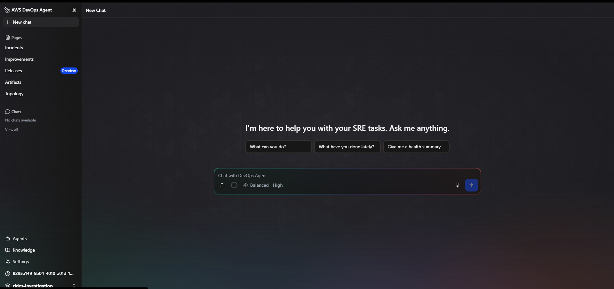
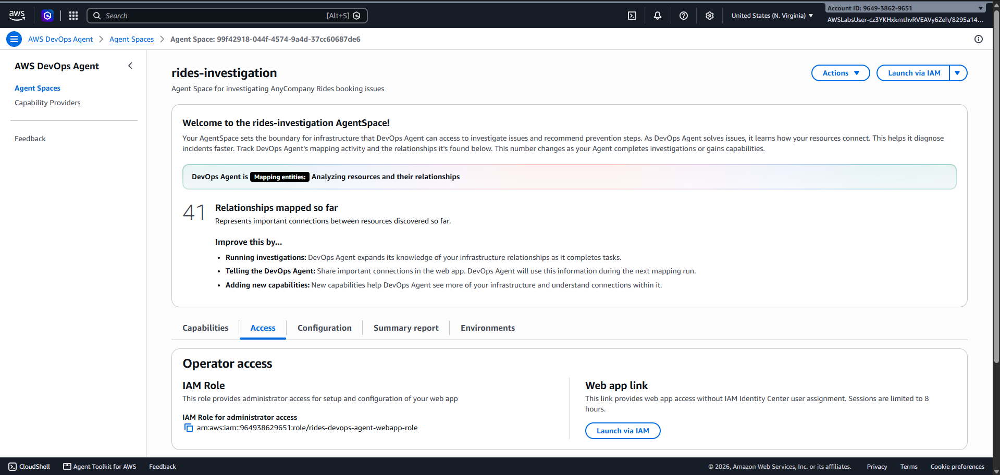
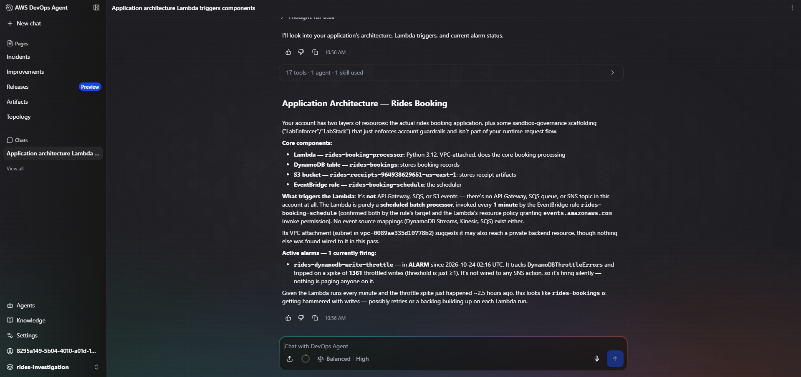
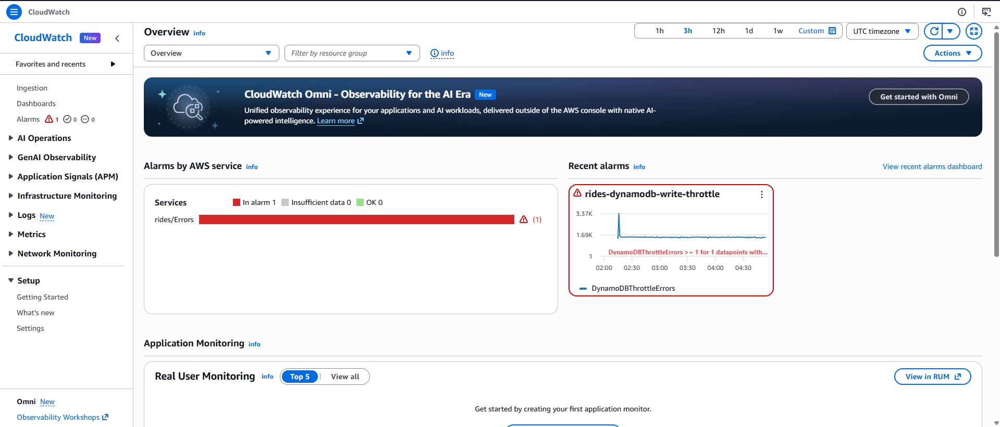
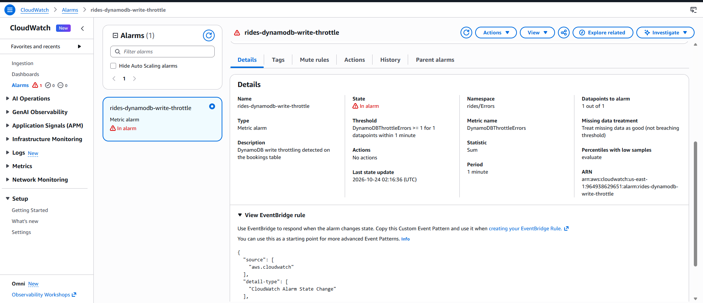
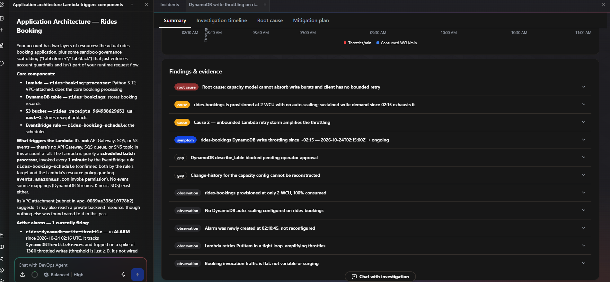
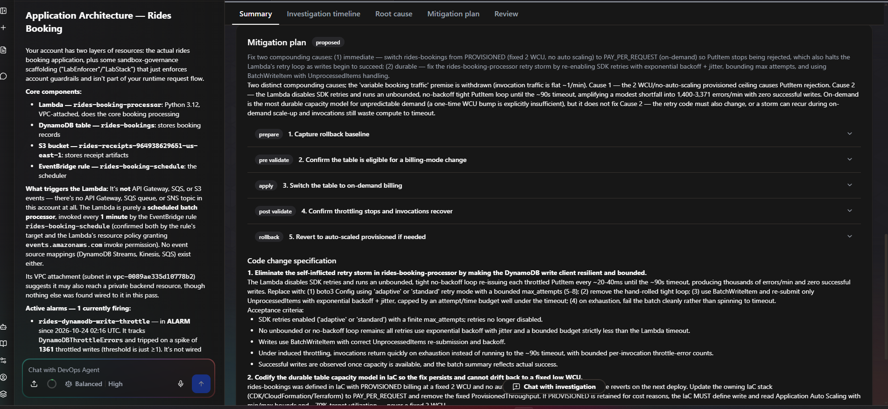
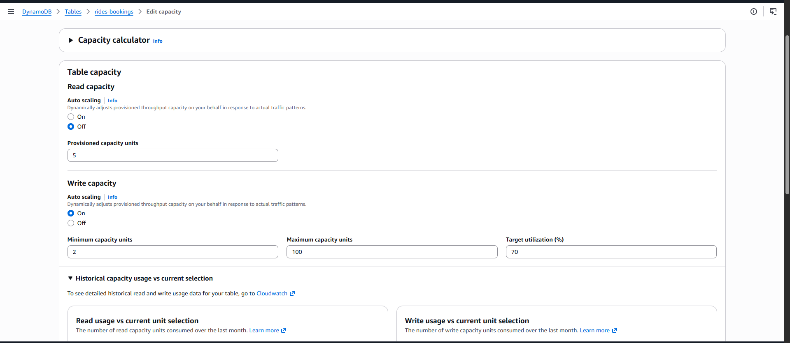

# Setting Up and Investigating an Incident with AWS DevOps Agent

Self notes from the lab *Setting Up and Investigating an Incident with AWS DevOps Agent* (SPL-TF-100-DOSIIA-1). The lab uses AWS DevOps Agent to investigate a DynamoDB write-throttling alarm in a small serverless application, then applies the recommended fix.

## Scenario

AnyCompany Rides is a ride-sharing startup with a serverless booking application:

- A **Lambda function** (`rides-booking-processor`) processes bookings.
- It writes booking records to a **DynamoDB table** (`rides-bookings`) and stores trip receipts in an **S3 bucket**.
- The Lambda runs in a private VPC and reaches AWS services through VPC endpoints.
- **CloudWatch** raises an alarm (`rides-dynamodb-write-throttle`) when throttling errors appear.
- An **EventBridge rule** runs the Lambda on a schedule to simulate booking traffic, which creates the throttling.

My job: set up a DevOps Agent Space, review the alarm, investigate with DevOps Agent, apply the fix, and judge whether the agent saves time compared with manual troubleshooting.

## What AWS DevOps Agent is

An AI-powered service that investigates operational problems in AWS environments. It correlates metrics, logs and resource configuration to find root causes and contributing factors, and it produces mitigation plans. The goal is to shorten the time between an alarm firing and an engineer knowing what to do.

Key terms:

| Term | Meaning |
|---|---|
| Agent Space | A defined boundary of AWS resources the agent can analyze for me |
| Operator Web App | The web interface where I run investigations and review findings |
| Topology | A map of discovered resources and how they connect |
| Investigation | A run where the agent gathers evidence, shows its reasoning, and reaches a root cause |
| Mitigation plan | An implementation-ready runbook generated from the root cause |

## Task 1: Set up the Agent Space and explore the application

### 1.1 Create the Agent Space

1. In the console, search for **DevOps Agent** and choose **Begin setup** (or **Create Agent Space** if it was used before).
2. Agent Space details:
   - Name: `rides-investigation`
   - Description: `Agent Space for investigating AnyCompany Rides booking issues`
3. AWS resource access: **Assign an existing role** and select `rides-devops-agent-space-role`.
4. Enable web app: **Assign an existing role** and select `rides-devops-agent-webapp-role`.
5. Choose **Create**. A green banner confirms creation. A yellow internal-tools banner can be ignored.





The agent starts mapping the application topology. The first mapping takes a couple of minutes, and the lab can continue while it runs.

### 1.2 Explore the application with DevOps Agent

Choose **Operator access** to open the Operator Web App. Main areas:

| Area | Purpose |
|---|---|
| Incidents | Past and in-progress investigations |
| Improvements | Proactive recommendations from the agent |
| Topology | Visual map of discovered resources |
| Artifacts | Reference material such as runbooks and architecture notes |
| Chat | Ask questions about the environment or an investigation in plain language |

Prompt used in the chat panel:

```
Describe my application architecture, including what triggers the Lambda function, and summarize the key components and any active alarms.
```

The response covers the architecture, the main components, what triggers the Lambda function, and the active alarm.



One prompt replaced a service-by-service tour of the console, and it included the connections between resources.

## Task 2: Review the alarm manually (the baseline)

Looking at the evidence myself first gives me something to compare the agent's findings against.

### 2.1 Confirm the alarm in CloudWatch

1. Open **CloudWatch**. The overview shows one active alarm.
2. Choose **Alarms**, then open `rides-dynamodb-write-throttle`. Status: **In alarm**.
3. On the **Details** tab:
   - Metric: `DynamoDBThrottleErrors` in the `rides/Errors` namespace
   - Fires at 1 or more datapoints within 1 minute





DynamoDB provisioned capacity is a hard limit. As soon as demand goes above what is provisioned, writes are rejected.

### 2.2 Review the Lambda logs

1. Open **Lambda**, then the `rides-booking-processor` function.
2. **Monitor**, then **View CloudWatch Logs**, then open the most recent log stream.
3. Look for `THROTTLE_ERROR` lines. They look like this:

```
THROTTLE_ERROR: An error occurred (ProvisionedThroughputExceededException) when calling the PutItem operation...
```

This confirms DynamoDB is rejecting the Lambda's writes.

## Task 3: Start an investigation

### 3.1 Start it

In the Operator Web App, go to **Incidents**, then **Start Investigation**.

- **Investigation details:** `The ride booking Lambda function is producing DynamoDB write throttling errors. The CloudWatch alarm for write throttling is active. We are evaluating a durable fix that handles variable booking traffic, not a one-time capacity bump.`
- **Investigation starting point:** the CloudWatch alarm for DynamoDB write throttling on the bookings table. The Lambda simulates production load with a synthetic tight loop, and the real workload will have variable traffic with unpredictable peaks. Investigate why the table rejects writes and recommend a fix.
- **Name:** `Rides Booking Throttle Investigation`

Clear context helps the agent focus on the right resources. Notice that the request asks for a durable fix and not just a capacity bump, and that the agent is told the traffic pattern is artificial.

### 3.2 Watch it run

The **Investigation timeline** tab shows the agent working in real time:

| Entry type | Meaning |
|---|---|
| Symptom | What the agent observed |
| Tool calls (for example `check-dynamodb-metrics`, `check-lambda-logs`) | What data it gathered |
| Observation | Evidence and charts backing the symptom |
| Finding | Conclusions drawn from the evidence |
| Root cause | The final summary |

The investigation is complete when the timeline shows **Investigation completed**. It takes several minutes. If the page stalls for a couple of minutes, refresh it.

Showing every step matters when the next step is a change to production, because I can check the reasoning before acting.

## Task 4: Review findings and apply the mitigation

### 4.1 Root cause analysis

Open the **Root cause** tab:

- **Impact:** the alarm that fired and the number of throttle errors.
- **Root causes:** the `rides-bookings` table has only **2 write capacity units (WCU)** against much higher demand, and **no auto scaling** is configured, so capacity stays fixed. **View observations** expands the evidence.
- **Key findings (contributing factors):** the Lambda's DynamoDB client has a **zero-retry configuration**, which makes the problem worse because throttled writes are not retried.



A manual check would probably stop at the first finding (low capacity). The agent also reported the contributing factor.

### 4.2 Generate the mitigation plan

Choose **Generate mitigation plan** (takes several minutes), then open the **Mitigation plan** tab.



The plan recommends raising provisioned write capacity and enabling Application Auto Scaling. It is written as a runbook with these phases:

1. **Preparation:** capture the current state so I can roll back.
2. **Pre-validate:** confirm the system is ready for the change.
3. **Apply:** make the change.
4. **Post-validate:** confirm the fix worked.
5. **Rollback:** the way back if something goes wrong.

This mirrors how AWS recommends changing production, and another engineer (or automation) could follow it.

### 4.3 Apply the fix

In **DynamoDB**, open `rides-bookings`, go to **Settings**, find **Read/write capacity**, and choose **Edit**.

- Capacity mode: **Provisioned** (unchanged)
- Write capacity auto scaling: **On**
- Minimum capacity units: `2`
- Maximum capacity units: `100`
- Target utilization: `70`

Choose **Save changes**.



What the values mean:

| Setting | Value | Reason |
|---|---|---|
| Minimum | 2 | The floor for provisioned capacity |
| Maximum | 100 | Headroom for spikes |
| Target utilization | 70% | Add capacity when the table runs above 70% of what is provisioned |

Confirm the result in **CloudWatch, Alarms**: `rides-dynamodb-write-throttle` should change from **In alarm** to **OK** after a few minutes. Four `TargetTracking-` alarms are created automatically by auto scaling and will move between In alarm and OK as capacity adjusts. They are normal.

## Lessons learned

- A single chat prompt gave me the architecture, the trigger, and the active alarm, which would have taken several console visits.
- Doing the manual check first (alarm, metric, logs) made the agent's findings easy to verify.
- The agent found a primary cause (2 WCU, no auto scaling) and a secondary one (zero retries). Contributing factors are easy to miss in a manual investigation.
- The investigation timeline shows the evidence, so the result can be checked instead of trusted blindly.
- Clear input produces better output. Describing the real goal (a durable fix for variable traffic) shaped the recommendation.
- The mitigation plan is a runbook with validation and rollback steps, not only a suggestion.
- Auto scaling gives bounds (min, max, target) and DynamoDB adjusts within them. The bounds should be revisited as traffic patterns change.

## Production considerations

- **Review before applying.** The agent proposes changes. A person should read the plan and approve it, especially for production tables.
- **Auto scaling reacts, it doesn't predict.** It adds capacity after demand rises, so a sudden burst can still throttle for a short time. For very spiky traffic, on-demand capacity mode is worth considering (it trades cost predictability for automatic handling).
- **Cost.** A maximum of 100 WCU sets an upper bound on the write cost. Choose the maximum deliberately.
- **Retries.** The zero-retry setting in the Lambda's DynamoDB client was only reported as a contributing factor. The lab's fix changes the table, not the code. A real fix should also enable retries with exponential backoff in the client.
- **Least privilege.** The agent's roles (`rides-devops-agent-space-role` and the web app role) define what it can see and do. Scope them to what an investigation needs.
- **Alarm hygiene.** The alarm fires on a single datapoint in one minute, which is very sensitive. A real alarm might need more datapoints before paging someone.

